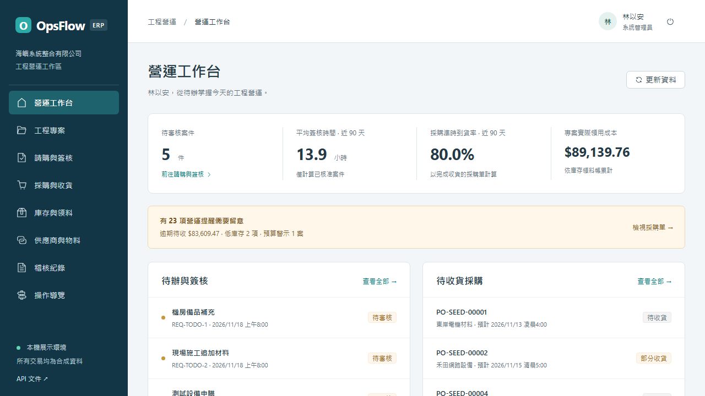
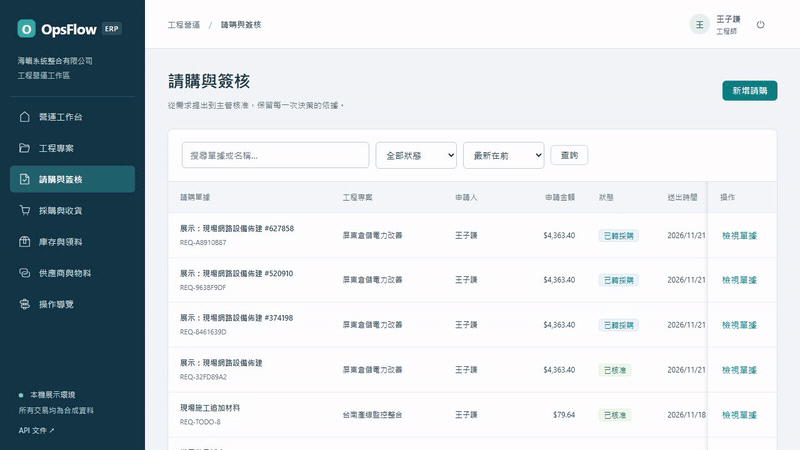
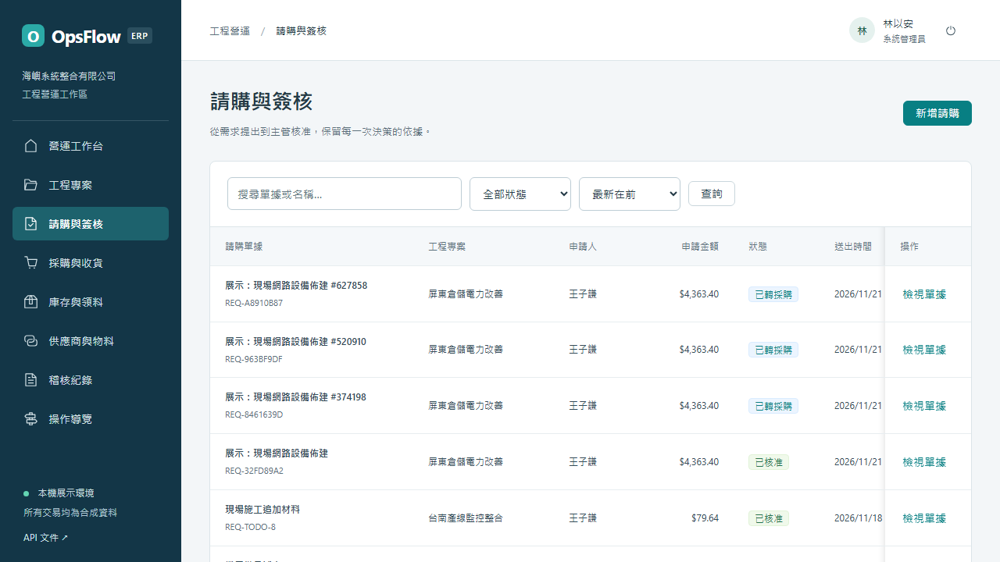
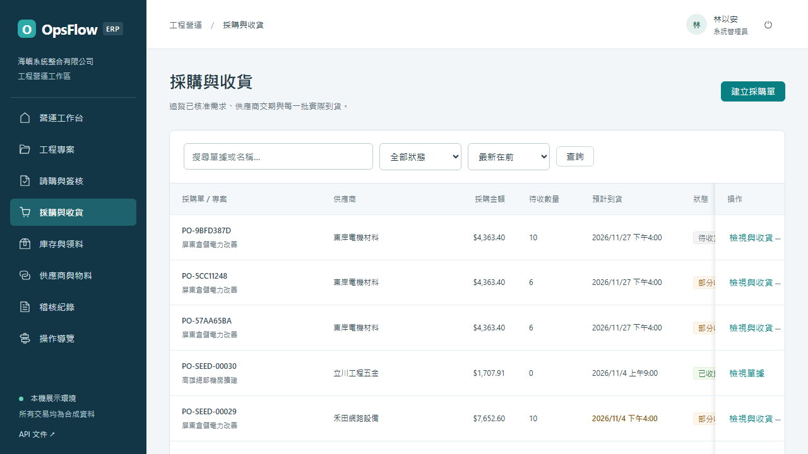
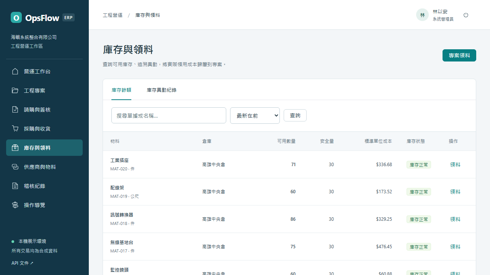
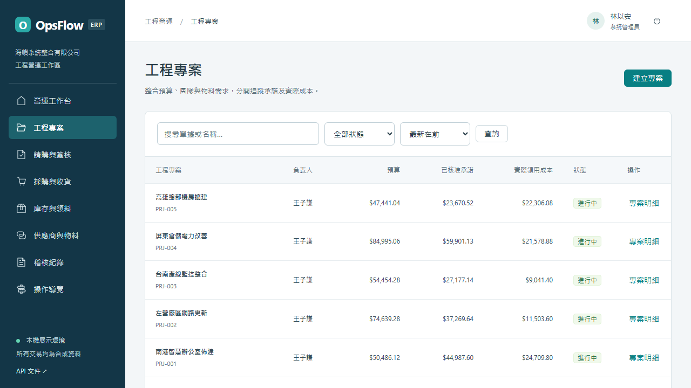
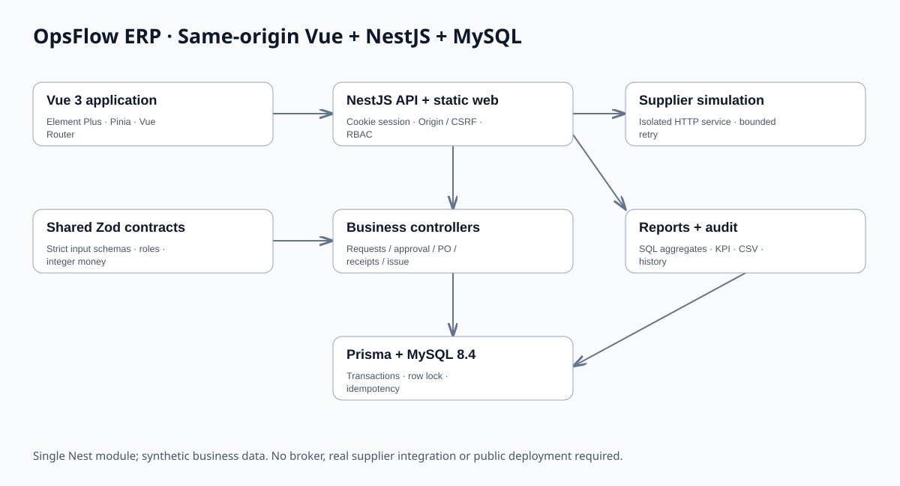

# OpsFlow ERP

以工程請購、簽核、採購、部分收貨與領料串起專案成本，展示跨角色業務流程與資料一致性。



## 操作展示



[觀看完整操作影片](docs/media/demo.mp4) · [跨角色操作指南](docs/portfolio/DEMO_INSTRUCTIONS.md) · [English project summary](docs/portfolio/PROJECT_SUMMARY.md)

影片與下方新截圖來自本機隔離 MySQL 展示環境，使用虛構企業「海嶼系統整合有限公司」與合成資料。前端實際呼叫 NestJS API，交易寫入 MySQL。影片檔隨 PR 交付，沒有新增公開服務；GitHub 若只顯示檔案頁，可下載播放。

## 解決的問題與功能畫面

工程採購常把請購、簽核、到貨與專案成本分散在不同表單。OpsFlow 以同一組單據串接角色，讓使用者追蹤目前卡在哪個階段，以及已承諾的採購金額和實際領料成本。

### 請購與簽核：保留單據狀態和退回紀錄

工程人員提出需求，同部門其他人員簽核；自批、越權與超出規則的狀態切換由後端檢查。



### 採購與部分收貨：追蹤待收數量

核准請購可建立唯一採購單。分批到貨逐筆入庫，不要求一次收齊，也不允許超收。



### 庫存與領料：從異動帳追查專案成本

領料以原子條件更新避免負庫存，並將成功交易寫入庫存異動與稽核紀錄。



### 專案與預算：分開呈現承諾金額和實際成本

成本來自實際單據及 SQL 彙總，頁面可查看預算與各專案進度。



## 架構與 Engineering Highlights



- **交易邊界集中在後端。** 收貨先鎖 PO，再更新數量、庫存、異動、稽核與 replay 結果；任一步驟失敗整筆 rollback。
- **重送與並行分開處理。** Idempotency Key 比對 actor、scope 和 payload；不同 Key 的收貨仍由資料庫鎖及條件更新保護。領料扣庫存失敗回 409。
- **維護案例有回歸依據。** 非同步搜尋覆寫、Session 過期恢復與核准預算競態，保留根因、修復及測試證據。
- **技術選擇維持單體。** Vue、NestJS 與共用 Zod 契約放在 npm workspaces；採單一 Nest module、按業務分檔，便於追查交易，沒有另外引入訊息佇列或微服務。

[架構與交易邊界](docs/architecture/SYSTEM_ARCHITECTURE.md) · [ADR](docs/decisions/ADR-001.md) · [真實修復紀錄](docs/maintenance/REAL_BUG_RECORDS.md) · [本次架構查核與媒體驗證](docs/SHOWCASE_VALIDATION.md)

## Testing & Results

歷史交付版本 `bc92260` 的 [CI 44629535764](https://github.com/Cizing24/opsflow-mini-erp/actions/runs/44629535764) 記錄 7 項 Unit、27 項真實 MySQL Integration、4 項 Chromium E2E，共 38 項通過；這是該版本結果，本次文件變更的重跑範圍另列在 [驗證報告](docs/SHOWCASE_VALIDATION.md)。

涵蓋最後一件庫存競爭、相同 Key 重送、超收、交易 rollback、權限與 Session 恢復。既有 Benchmark 使用 100,706 筆異動、1,080 次讀 API 樣本及並行 1／4／16；量測條件、原始值與限制見 [Benchmark Results](docs/benchmarks/RESULTS.md)。它是本機短測，不能外推為正式 SLA。故障注入、Migration 與備份還原演練另列為模擬驗證。

## 本機啟動（Windows + PowerShell + Docker Desktop）

```powershell
git clone https://github.com/Cizing24/opsflow-mini-erp.git
cd opsflow-mini-erp
./scripts/init.ps1
```

開啟 **http://localhost:3000**。首次會建立本機 .env、建置容器、執行 Migration 與 Guided Seed，等待 app healthy。再次啟動保留既有資料；初始化程式不重置 demo。

登入帳號：`admin@opsflow.test`、`manager@opsflow.test`、`engineer@opsflow.test`、`buyer@opsflow.test`、`warehouse@opsflow.test`。密碼在本機 .env 的 DEMO_PASSWORD，不放進 Git。右上角登出可切換角色。網站「操作導覽」可依序完成跨角色流程。

## 已實作

- 專案預算、狀態、負責人、成員及物料需求；承諾金額與實際成本分開追蹤。
- 多明細請購、同部門他人簽核、核准／退回／拒絕及重送歷程。
- 核准單建立唯一 PO、預計交期、分批收貨與待收數量。
- 倉庫庫存、不可編輯的異動帳、專案領料、Idempotency 與並行負庫存防護。
- Cookie Authentication、CSRF、後端 RBAC、輸入驗證、Audit Log、Request ID、rate limit。
- 即時 Portal KPI、專案成本報表、CSV、Swagger/OpenAPI、供應商 timeout 模擬服務。
- 固定 seed 三種資料模式、公開商品目錄轉換、實測 Benchmark、Migration 故障與備份還原演練。

## 技術架構

Vue 3 + TypeScript + Vite + Element Plus + Pinia；NestJS Modular Monolith；Prisma 7 + 官方 MariaDB adapter + MySQL 8.4；Vitest + Playwright；Docker Compose + GitHub Actions。版本鎖定在 package-lock.json，Node 24.11–24.x。

```text
apps/web         Vue 操作介面
apps/api         認證、主檔、採購、庫存、報表及整合
packages/shared  Zod 輸入契約、角色／狀態與共用格式
prisma           schema、可追蹤 migration、固定 seed
data             公開資料清洗、mapping、manifest
tests            Unit / MySQL Integration / E2E / Simulation / k6
scripts          初始化、量測、演練、備份及證據匯出
docs             架構、業務、資料、測試、維護與作品集材料
```

## 資料與來源

| 模式      | 專案 |    PO | 庫存異動 |
| --------- | ---: | ----: | -------: |
| Guided    |    5 |    30 |       60 |
| Business  |   50 | 1,000 |      706 |
| Benchmark |   50 | 1,000 |  100,706 |

Guided 初始有 20 個合成物料；歷史交付環境另外匯入 100 個 UCI 公開來源衍生商品，共 120。乾淨啟動不會自動匯入公開目錄。UCI 為歷史零售資料，僅保留商品代碼與名稱；成本是合成欄位，沒有把零售交易冒充工程簽核。WWI 已查證官方來源與授權，未匯入。見 [Data Sources](docs/data-sources/DATA_SOURCES.md)、[第三方聲明](THIRD_PARTY_NOTICES.md)。

ERP 可直接使用合成 seed 啟動；下列指令另外下載、整理並匯入公開商品目錄。只有在來源 ZIP 已快取時，資料整理步驟才可離線執行：

```powershell
npm ci
npm run db:generate
npm run build -w @opsflow/shared
python data/generators/prepare-uci.py
npm run data:public
```

## 開發與驗證

需 Node 24 及已啟動的 Compose db。`.env.example` 可供參考，但 DEMO_PASSWORD 需自行設定至少 12 字元。

```powershell
npm ci
npm run db:generate
npm run db:migrate
npm run seed
npm run dev:api
# 另開終端；APP_ORIGIN 使用 http://localhost:5173
npm run dev:web

npm run lint
npm run typecheck
npm run build
npm test
node --import tsx scripts/test-database.ts --setup --reset
npx playwright install chromium
npm run test:e2e
npm run data:check
node --import tsx scripts/fault-drills.ts
node --import tsx scripts/backup-restore.ts
```

Integration 使用 opsflow_test，E2E 使用 opsflow_e2e，均不重置 demo。測試結果與 RED/GREEN 在 [docs/testing](docs/testing/TEST_STRATEGY.md)。故意失敗的 Simulation fixture 不屬正常測試通過率。

## Benchmark

```powershell
node --import tsx scripts/test-database.ts --setup --benchmark --reset
# 將 DATABASE_URL 改為同一 MySQL 的 opsflow_benchmark，再執行：
npm run benchmark
```

腳本拒絕 demo DB，輸出 Avg／P50／P95／P99、throughput、error rate、不同並行、SQL EXPLAIN、索引前後及深分頁實測。[方法](docs/benchmarks/METHODOLOGY.md)與[原始結果](docs/benchmarks/results.json)包含環境與 commit；這是本機短測，不能外推為正式 SLA。

## 文件與展示

- [產品](docs/PRODUCT_OVERVIEW.md)、[需求驗收](docs/REQUIREMENTS.md)、[業務流程](docs/business-process/WORKFLOW.md)
- [架構](docs/architecture/SYSTEM_ARCHITECTURE.md)、[ERD](docs/architecture/ERD.md)、[ADR](docs/decisions/ADR-001.md)、[API](docs/api/API_GUIDE.md)
- [Data Dictionary](docs/data-sources/DATA_DICTIONARY.md)、[Seed Guide](docs/data-sources/SEED_GUIDE.md)、[KPI](docs/KPI_DEFINITIONS.md)
- [維運](docs/maintenance/RUNBOOK.md)、[Migration](docs/maintenance/MIGRATION_GUIDE.md)、[備份還原](docs/maintenance/BACKUP_RESTORE.md)、[真實 Bug](docs/maintenance/REAL_BUG_RECORDS.md)、[Simulation](docs/maintenance/FAULT_INJECTION.md)
- [中英作品摘要](docs/portfolio/PROJECT_SUMMARY.md)、[技術重點](docs/portfolio/TECHNICAL_HIGHLIGHTS.md)、[Demo 操作](docs/portfolio/DEMO_INSTRUCTIONS.md)、[截圖](docs/screenshots)
- [設計系統](DESIGN.md)、[UI 審查範圍](docs/design/ui-review.md)、[已知限制](docs/KNOWN_LIMITATIONS.md)

## 重要界線

本作品沒有公開部署、真實企業資料或付款。沒有總帳、稅務、移動平均估價與庫存期間快照；周轉率回 null。正式環境仍需 HTTPS、帳號生命週期、備份政策及多副本 limiter。PR 不自動合併，最終 Commit／CI／交付狀態見 docs/DELIVERY_REPORT.md。

License：程式碼 MIT；UCI 衍生目錄依 CC BY 4.0 歸屬。
