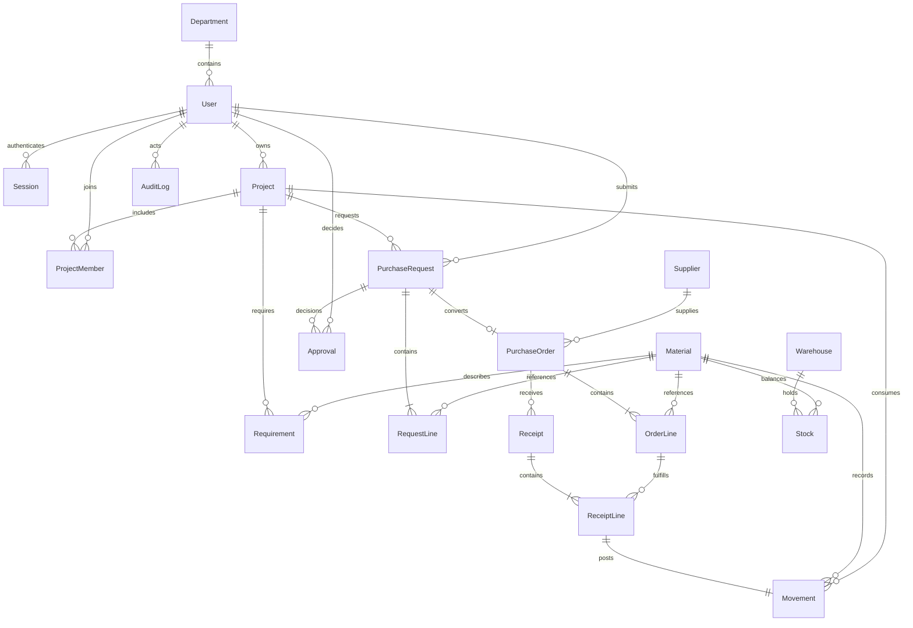

# 資料關聯

Request → PO 為 unique 1:0..1。Stock 的主鍵是 warehouseId + materialId。ReceiptLine → Movement 由 unique receiptLineId 保證單次入庫。Idempotency 以 client key 為主鍵，同時核對 actor、scope 與 payload hash。完整外鍵、索引及 enum 以 prisma/schema.prisma 為準；初始 Migration 是實際 MySQL DDL，並已套用。
