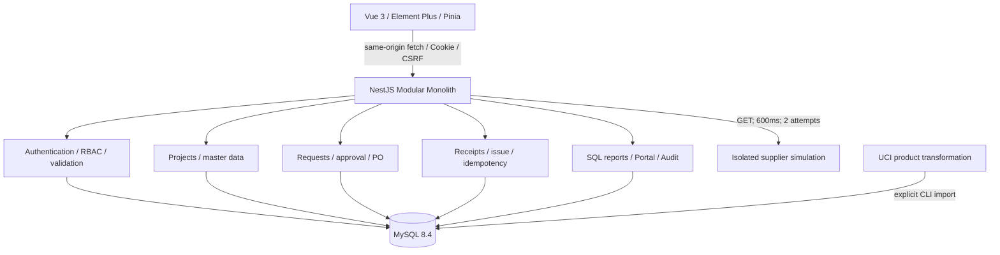

# 系統架構

採單一 Nest module、按認證、主檔、採購、庫存、報表、整合分檔的 Modular Monolith；沒有 Message Broker 或微服務。Prisma 7.10.1 透過官方 MariaDB driver adapter 連接 MySQL。Prisma 8 當日 registry 為 RC，未使用。Node 24.22.1、Vue 3.5.45、Vite 8.3.8 與 Nest 11.2.11 的安裝、Typecheck、Build 及實際 MySQL 測試均有執行；完整解析版本在 package-lock.json。

## 交易邊界

收貨先保留 Idempotency Key，再鎖 PO、條件增加 receivedQty、upsert Stock、建立 ReceiptLine 與 Movement、更新狀態與 Audit，最後保存 replay 結果，全部位於同一個 READ COMMITTED transaction。任一步失敗整筆 rollback。

領料用 `UPDATE Stock ... WHERE quantity >= requested` 原子扣庫存；受影響列為 0 時回 409。成功時才建立 Movement 與 Audit。同 Key 同 actor/scope/payload 回原結果；Key 重用於不同請求回 409。唯一鍵衝突後只 replay 已提交的相同請求，不安全重試任意寫入。

## 認證與請求

scrypt 加隨機 salt 儲存密碼。Session cookie 為 256-bit 隨機值、HttpOnly、SameSite Strict、8 小時有效，DB 只存 SHA-256 token hash。正式模式加 Secure；本機 HTTP 使用 development。所有寫入要求精確 Origin，session 寫入再要求與 DB 相符的 X-CSRF-Token。Zod strict schemas 拒絕額外寫入欄位。

Helmet 提供安全 headers；Swagger route 為載入官方 UI 所需的限定 inline script 例外。每個請求由伺服器產生 UUID Request ID，log 不記 body、cookie、密碼或 query 字串；錯誤回應不含 stack/SQL。

## 操作環境

Compose 只綁定本機介面：app 3000、MySQL 3307；供應商模擬服務只在 Compose network。容器以非 root Node 使用者執行。開發模式可在 5173 使用 Vite proxy，正式編譯檔由 Nest 靜態提供。環境檔與 web dist 由模組路徑定位，不依賴啟動 cwd。
