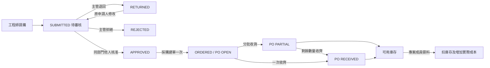

# 業務流程與 Use Cases

## 正常案例

請購 10 件，主管核准後承諾金額為 10 × 請購時的單價快照。採購建 PO 後不再增加一次承諾。首次收 4 件時，PO 狀態 PARTIAL、待收 6、指定倉庫增加 4；再收 6 後為 RECEIVED。工程師領 1 件時，可用量減 1，專案實際成本增加 1 × 物料固定標準單位成本。

## 異常及邊界

未登入回 401；角色或專案成員不符回 403。核准前建 PO、重複建 PO、再次簽核、非退回單重送、超收、庫存不足皆回 409。數量必須是正整數；重複物料與額外狀態欄位回 400。

主管不能簽自己的單；MANAGER 只可簽 requester 目前所屬同部門的單，ADMIN 可跨部門但也不能自簽。核准先鎖 Request，再鎖 Project，重新讀取明細與承諾總額，避免重送與預算核准競爭。核准後承諾不可超過預算；調降專案預算也不可低於既有承諾。

## 單據與成本口徑

RequestLine 與 OrderLine 保存單價快照；物料標準成本建立後不提供一般線上修改。採固定標準成本，未處理運費、折扣、稅或匯率。預算承諾與實際領用各自顯示，不能加總當作同一筆預算耗用。

收貨明細以 ReceiptLine 連到唯一入庫 Movement；出庫 Movement 連到 Project。收貨沒有直接歸屬專案成本，避免「入庫即認列、領料又認列」的重複計算。
